**EBS Práctica**

Rafael Moreno Riquelme

2 FPS DAM

Índice

[1\. Añadir nuevo disco independiente 2](#1-añadir-nuevo-disco-independiente)

[1\. Crear volumen 3](#1-crear-volumen)

[2\. Asociar Volumen 3](#2-asociar-volumen)

[3\. Montar disco 4](#3-montar-disco)

[4\. Configurar el disco autoarrancable 5](#4-configurar-el-disco-autoarrancable)

[2\. Ampliar capacidad de disco 6](#2-ampliar-capacidad-de-disco)

[3\. Crear instantánea 8](#3-crear-instantánea)

# 1. Añadir nuevo disco independiente

## 1. Crear volumen

Creamos un volumen de Amazon de EBS con 12GB y añadimos la etiqueta con clave Name y valor webRMR, para que muestre un nombre y poder diferenciarla.

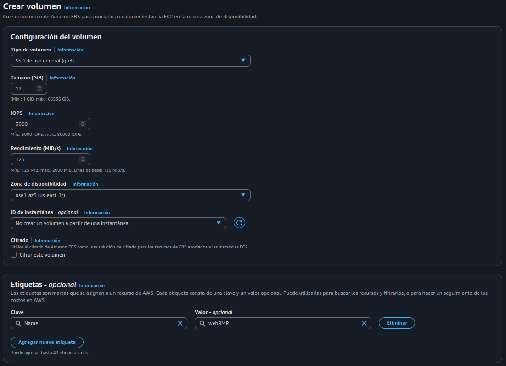

## 2. Asociar Volumen

Asociamos el volumen a la instancia donde se aloja el servidor y ponemos el nombre de dispositivo en la raíz /dev/sd\[f-p\].

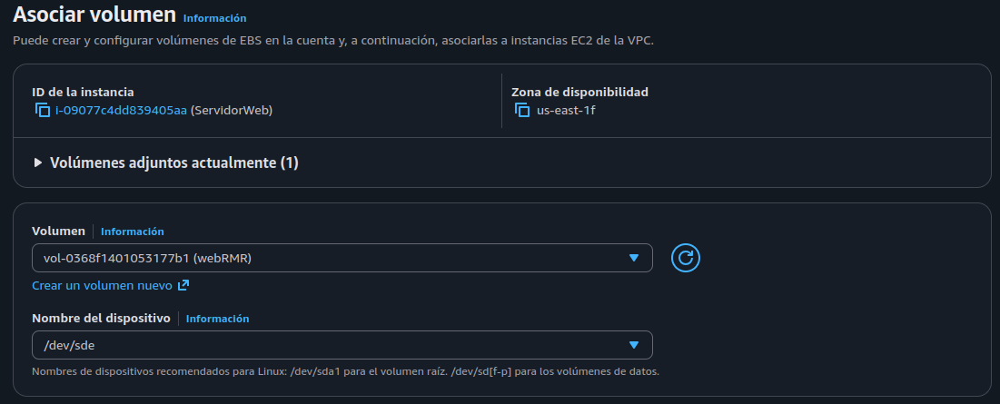

Aquí podemos comprobar que la instancia tiene nuestro volumen asociado.

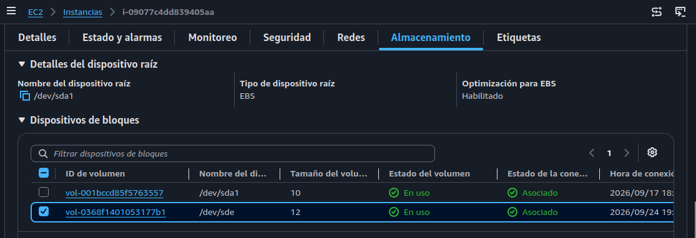

## 3. Montar disco

Usamos sudo lsblk para ver el volumen asociado.

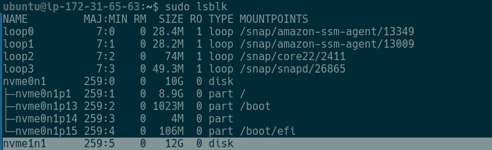

Configuramos al disco el sistema de archivo de Linux (ext4).

`sudo mkfs -t ext4 /dev/nvme1n1`

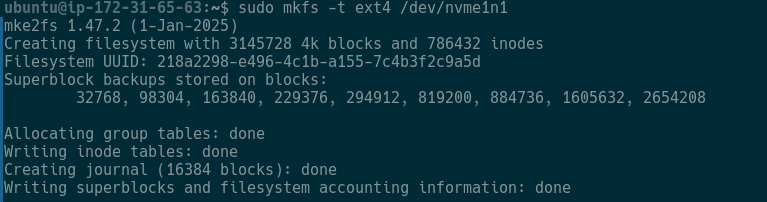

Montamos en la carpeta /mnt y generamos la carpeta webRMR.

`sudo mount /sev/nvme1n1 /mnt`

`sudo mkdir /mnt/webRMR`

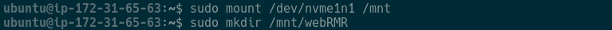

## 4. Configurar el disco autoarrancable

Usamos `sudo blkid` para ver su identificador (UUID).

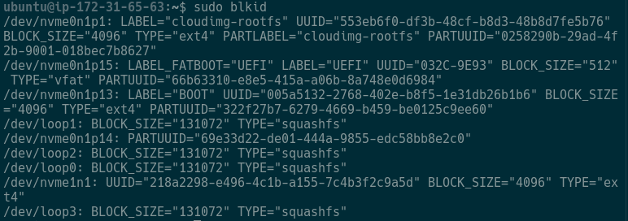

Añadimos en el fichero /etc/fstab/ la línea `UUID=cac49809-b7c0-4ef0-9501-a0e05dad237f /mnt ext4 defaults,nofail 0 2` con el UUID del disco.

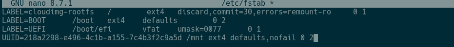

Utilizamos:

# Desmontar si estaba previamente montado.

sudo umount /mnt

# Montar desde el fichero fstab.

sudo mount -a

# Comprobar si efectivamente se ha montado.

lsblk –f

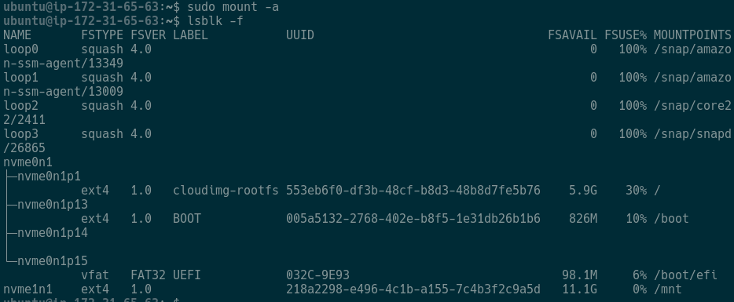

# 2. Ampliar capacidad de disco

La empresa necesita ampliar la capacidad del disco a 15GB, por lo que editamos el volumen y añadimos hasta tener 15GB.

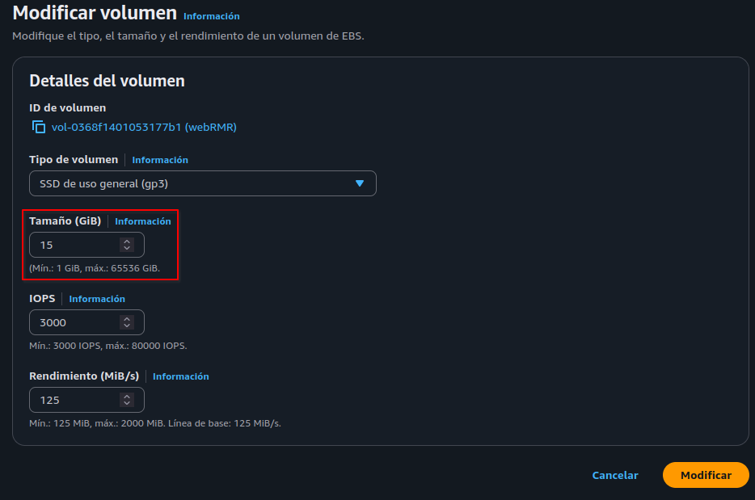

Podemos ver con lsblk, que se ha realizado el cambio, pero si usamos df –h podemos ver que la partición no está ocupando todo el disco y mantiene los originales.

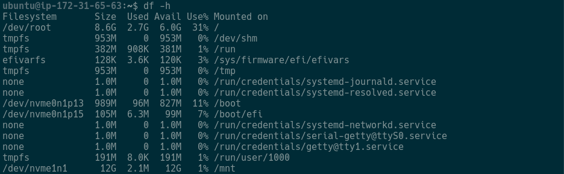

Usando `sudo resize2fs /dev/nvme1n1` redimensionamos el disco para que ocupe el espacio real, con `df –h` comprobamos que usa todo el disco.

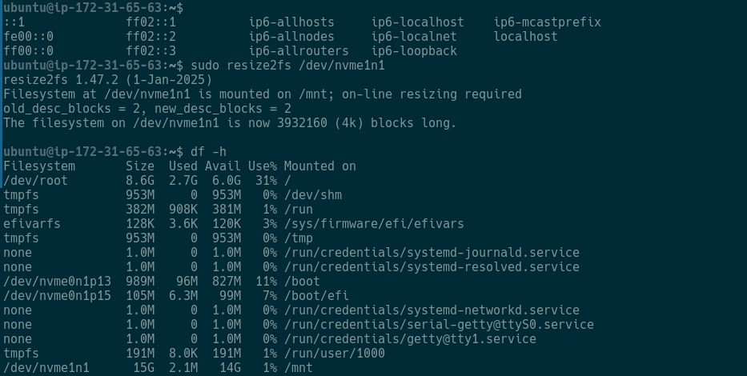

# 3. Crear instantánea

La empresa necesita crear una instantánea, por lo que creamos una a partir del volumen.

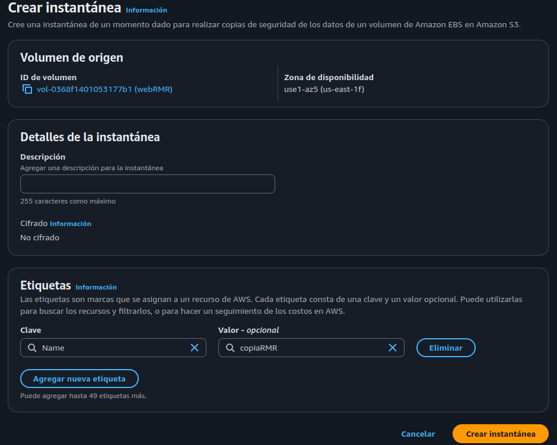

Creamos un volumen basado en la instancia:

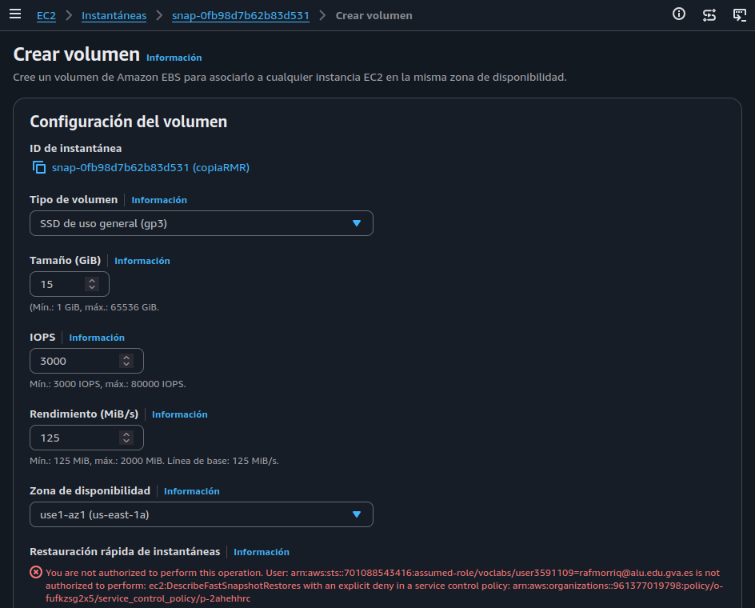

Asociamos el volumen de la nueva copia con el nombre de dispositivo en la raíz /dev/sd\[f-p\].

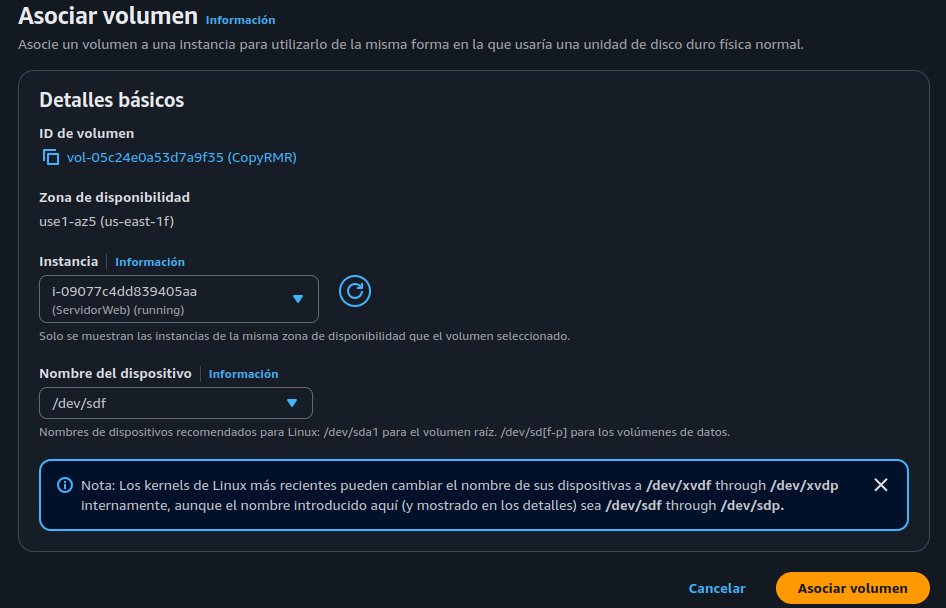

Comprobamos que el volumen está asociado:

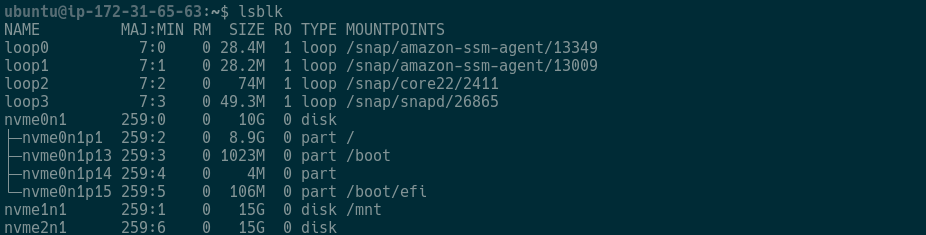

Creamos la carpeta /home/Ubuntu y montamos la copia, comprobamos que dentro de la carpeta está la carpeta webRMR, lo que quiere decir que se copió el volumen correctamente.

`sudo mkdir /home/Ubuntu`

`sudo mount /dev/nvme2n1 /home/Ubuntu`

`ls /home/Ubuntu` (muestra webRMR)

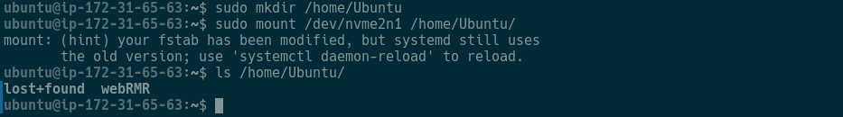