**EFS Práctica**

Rafael Moreno Riquelme

2 FPS DAM

Índice

[1\. Crear EFS 2](#1-crear-efs)

[1.2 Grupo de seguridad 3](#12-grupo-de-seguridad)

[1.3 Montar EFS en EC2 4](#13-montar-efs-en-ec2)

[2\. Montaje auto arrancable 5](#2-montaje-auto-arrancable)

[4\. Generar AMI 6](#4-generar-ami)

[5\. Crear máquina de la AMI 7](#5-crear-máquina-de-la-ami)

[6\. Comprobar funcionamiento EFS 8](#6-comprobar-funcionamiento-efs)

# 1. Crear EFS

Seleccionamos en personalizar, elegimos una única zona y seleccionamos la de nuestra máquina, en mi caso us-east-1f.

Deshabilitamos la copia de seguridad automática y la Administración del ciclo de vida como ninguna.

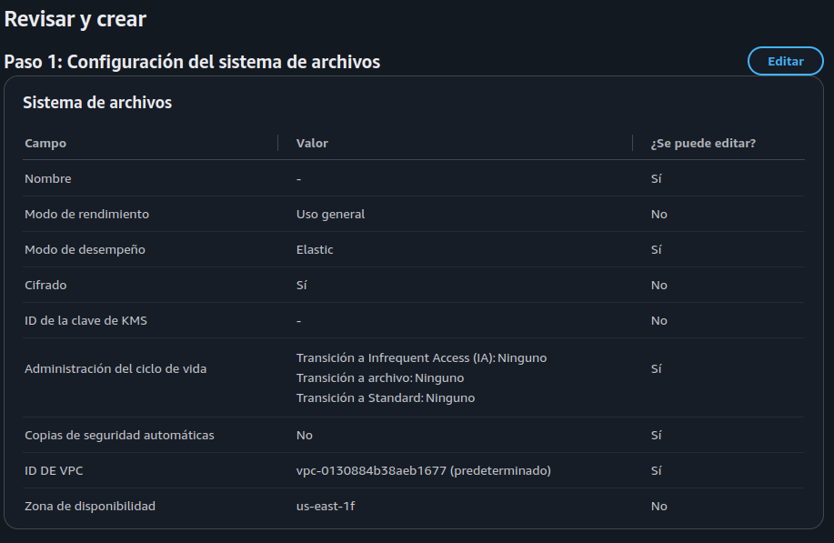

## 1.2 Grupo de seguridad

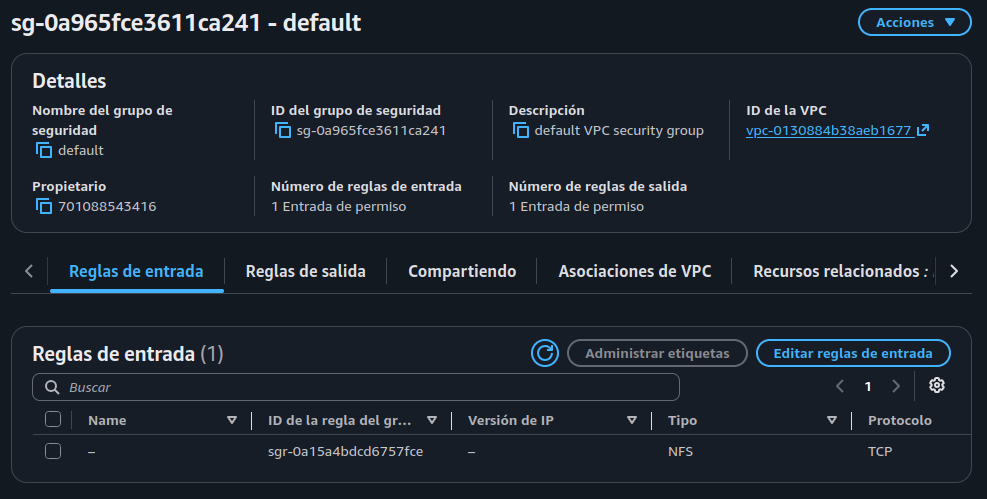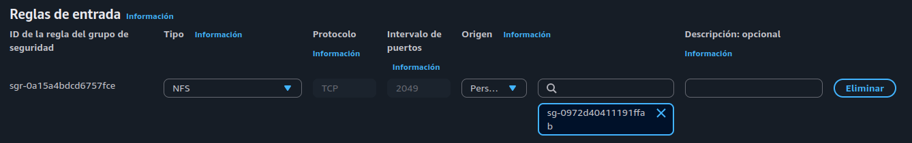

El grupo de seguridad Default, modificamos la regla para que acepte la entrada solo del grupo de seguridad de nuestra instancia servidor.

Lo más correcto, seria crear un grupo de seguridad y asociarlo al Mount Target del EFS.

## 1.3 Montar EFS en EC2

Entramos a nuestra máquina, actualizamos los paquetes e instalamos los necesarios para usar el protocolo NFS.

sudo apt install nfs-common

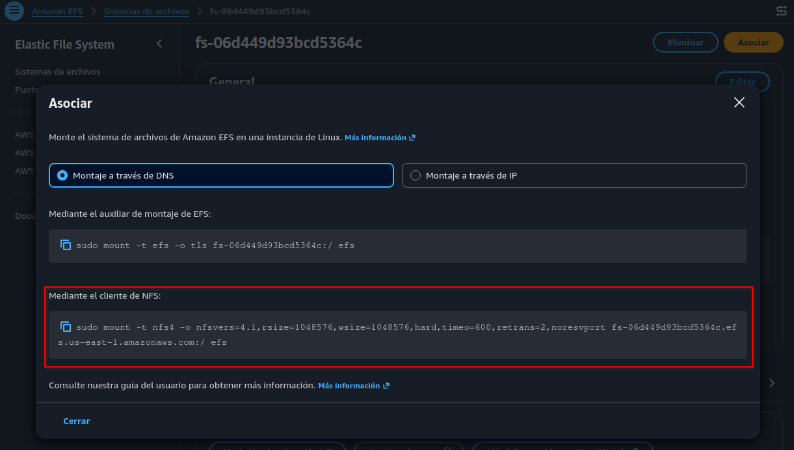

En el apartado de NFS Pulsamos en Asociar y copiamos el comando para asociar nuestra instancia mediante el cliente de NFS, el argumento final efs es el directorio donde se montará, por lo que indicaremos /var/www/html .

Antes, copiamos el contenido a una carpeta temporal, tras montar, copiamos a /var/www/html/ con cp –a

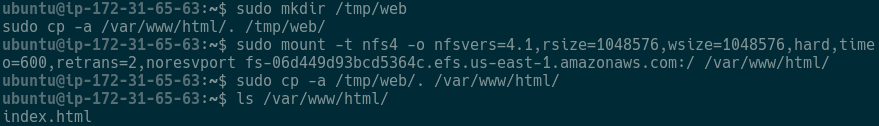

Con df –h , comprobamos que está montado.

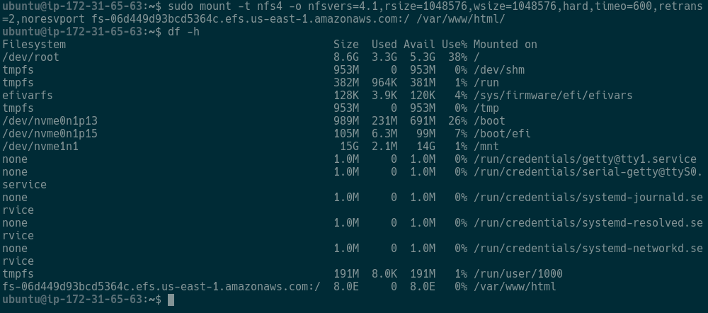

# 2. Montaje auto arrancable

Para que el EFS se monte automáticamente en el fichero /etc/fstab añadimos lo siguiente:

\[fs-XXXXXXXX\].efs.\[REGION\].amazonaws.com:/ /path/to/mount/dir nfs4 defaults,\_netdev 0 0

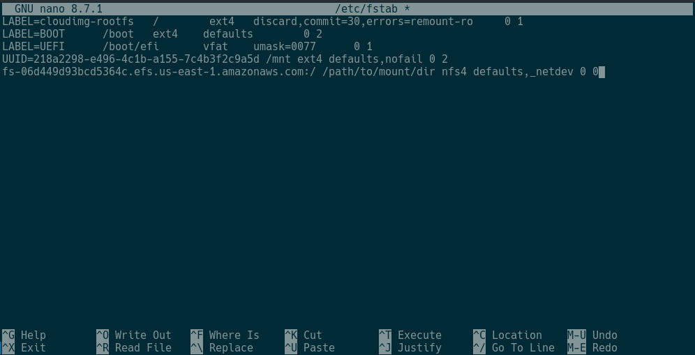

# 4. Generar AMI

En el menú de instancia Acciones -> Imágenes y Plantillas -> Crear Imagen

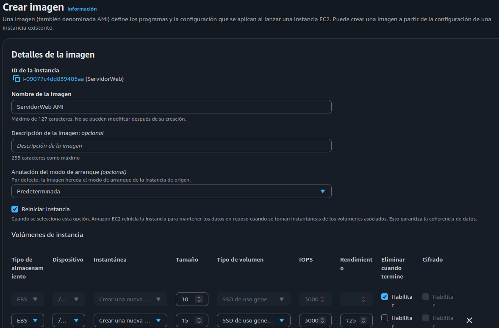

# 5. Crear máquina de la AMI

En instancias, lanzamos una nueva y seleccionamos la AMI que creamos anteriormente.

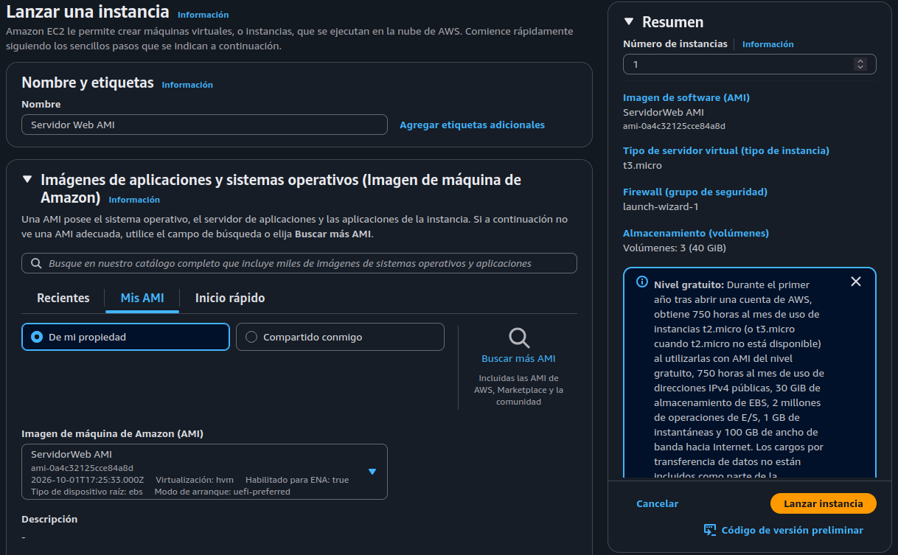

Importante seleccionar el mismo grupo de seguridad y zona de disponibilidad que nuestra instancia del servidor.

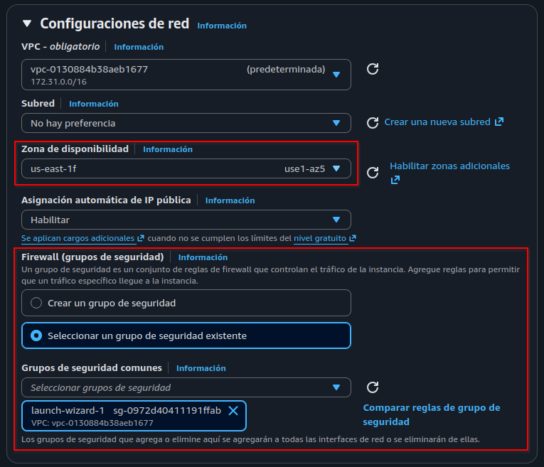

# 6. Comprobar funcionamiento EFS

Dentro de la instancia principal, en /var/www/html modificamos unas líneas del index.html

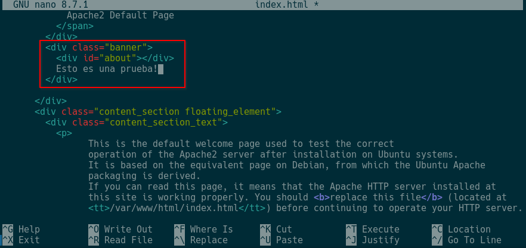

Abrimos el panel de nuestra instancia creada con nuestro AMI, y entramos a su dirección y podemos ver que se muestra el mismo archivo:

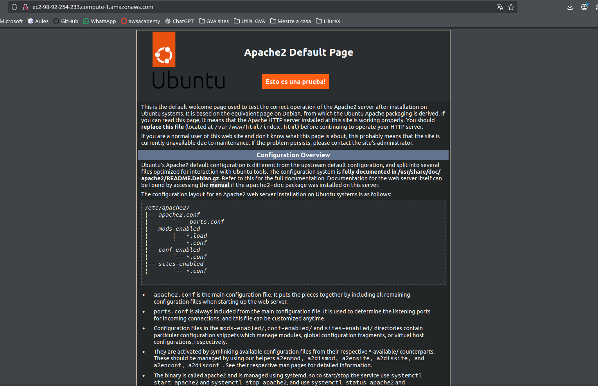